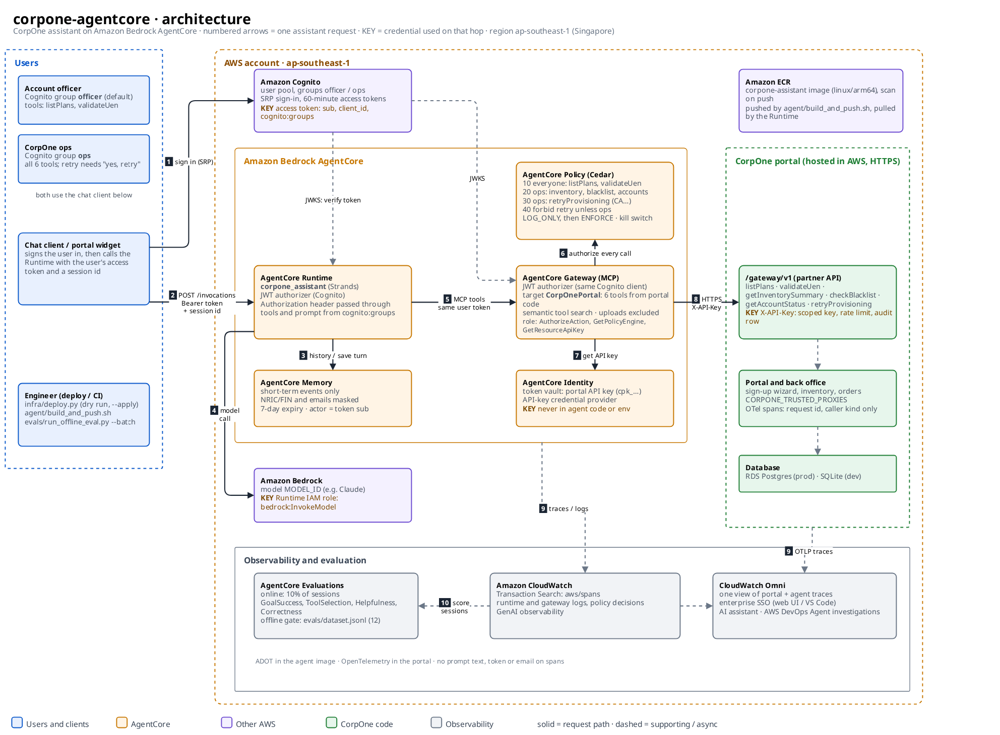
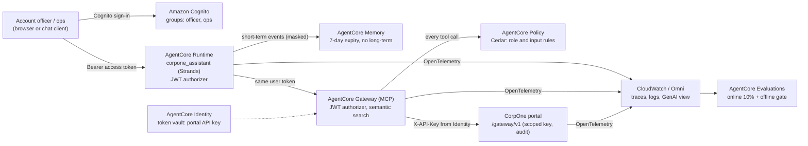

# corpone-agentcore

The CorpOne corporate bulk-line portal plus an AI assistant built on **Amazon Bedrock AgentCore**:
Identity, Gateway, Policy, Memory (short-term), Runtime, Observability and Evaluations.

Status: **built and tested locally; not deployed.** `infra/deploy.py` is a dry run until you pass `--apply`.

## Layout

| Folder | What it is |
|---|---|
| `portal/` | The CorpOne portal (copied from `corpone-portal`), plus AgentCore groundwork: stable tool names on `/gateway/v1`, a Gateway-ready OpenAPI export, trusted-proxy client IPs, optional OpenTelemetry tracing with personal data masked |
| `agent/` | `corpone_assistant`: Strands agent for AgentCore Runtime. Role from the Cognito token, the user's own token forwarded to the Gateway, per-role tools, short-term memory with NRIC/email masking. `Dockerfile` (linux/arm64) and `build_and_push.sh` |
| `infra/` | Deployment as an ordered list of 21 AWS requests (`corpone_infra/plan.py`), `deploy.py` (dry run / `--apply`, resumable), `destroy.py`, Cedar policies in `policies/` |
| `evals/` | 12-scenario test set for both roles and `run_offline_eval.py` (local scoring + AgentCore batch evaluation; release gate) |
| `notebooks/deploy_to_production.ipynb` | Step-by-step production deployment with gates: preflight (including IAM/SCP access per service), image build, dry run, deploy in `LOG_ONLY`, smoke test per role, direct Gateway policy check, evaluation gate, switch to `ENFORCE`, observability check, go-live checklist and rollback. Safe by default (`CONFIRM_DEPLOY = False`); regenerate with `notebooks/make_notebook.py` |
| `docs/OPERATIONS.md` | Observability (CloudWatch Omni), policy rollout, kill switch, evaluations, cost, tear-down |

## Architecture



Editable: [docs/architecture_agentcore.drawio](docs/architecture_agentcore.drawio) (generated by `python3 docs/make_architecture_drawio.py
docs/architecture_agentcore.drawio`; once edited in draw.io, treat the `.drawio` file as the source). The numbered arrows are
one assistant request; **KEY** marks the credential used on each hop. The same flow as Mermaid:



| AgentCore service | How this project uses it |
|---|---|
| **Identity** | Cognito JWTs on the Runtime and the Gateway (inbound); Cognito Managed Login (hosted page, authorization code + PKCE, no self sign-up) for the portal's `/assistant` chat page. The portal API key is stored in the Identity token vault and added by the Gateway (outbound); no secret is in the agent or its environment |
| **Gateway** | The portal's partner API as 6 MCP tools generated from the code (`listPlans`, `validateUen`, `getInventorySummary`, `checkBlacklist`, `getAccountStatus`, `retryProvisioning`); uploads are never exposed |
| **Policy** | 4 Cedar policies: everyone may list plans and validate UENs; only `ops` may read inventory, blacklist and accounts; retrying provisioning is ops-only, needs a `CA…` account number, and is also covered by a `forbid` that no future permit can override. Starts in `LOG_ONLY`, then `ENFORCE`. Optional kill switch |
| **Memory** | Short-term only: one event per turn, NRIC/FIN and emails masked, events expire after 7 days, actor = token subject (never the email). Long-term memory is off pending a privacy review |
| **Runtime** | Hosts the assistant container; the `Authorization` header is passed through so the user's identity reaches the Gateway |
| **Observability** | ADOT in the agent image; optional OpenTelemetry in the portal (`CORPONE_OTEL_ENABLED`) with query values and caller emails removed; X-Request-ID on spans links portal logs and traces |
| **Evaluations** | Online: 10% of sessions with GoalSuccessRate, ToolSelectionAccuracy, Helpfulness, Correctness. Offline: `evals/` scenarios as a release gate, optionally scored by AgentCore batch evaluation |

### Two roles

| Role (Cognito group) | Tools | Typical questions |
|---|---|---|
| `officer` (default) | listPlans, validateUen | "Which plan suits 50 staff?", "Is UEN 197401143C valid?", "What do I need for sign-up?" |
| `ops` | all 6 | "Which categories are low on eSIM lines?", "Status of CA…?", "Retry CA…" (asks for an explicit "yes, retry") |

Officers deliberately get no inventory, blacklist or account tools: the partner API is company-wide, so those
would show other companies' data. **Next step** for per-officer data: a Gateway target with
`JWT_PASSTHROUGH` to a portal endpoint that verifies the Cognito token and scopes results to that officer.

## Assistant page in the portal

`/assistant` (e.g. `https://<host>/ports/8501/assistant`) signs the user in through Cognito Managed Login and chats
with the assistant. The portal relays each message to AgentCore Runtime with the user's own access token
(`POST /api/assistant/invoke`, rate-limited per client); the Runtime, Gateway and Policy check that token, so the
portal never decides who the user is. The page is off until the portal is started with the settings
`infra/deploy.py` writes to `infra/build/portal-assistant-<project>-<region>.env`. Users are admin-created (the
notebooks can invite one with a temporary password); there is no self sign-up.

## Run the tests (no AWS calls)

```bash
uv venv .venv && uv pip install --python .venv/bin/python -r requirements-dev.txt
scripts/test_all.sh            # portal 94 · agent 10 · infra 23 · evals 3
```

The infra tests validate every deployment request against the real AWS API models (types, lengths, enums
and naming patterns); the deploy/destroy tests run against a fake AWS session.

## Deploy (when you're ready)

Prerequisites: the portal is hosted in AWS and reachable over HTTPS; a portal API key with scopes
`plans:read validation:read inventory:read accounts:read provisioning:write`; Docker; a Bedrock model
available in the region.

```bash
cp infra/.env.example infra/.env && $EDITOR infra/.env      # region, PORTAL_GATEWAY_URL, MODEL_ID
set -a; . infra/.env; set +a
agent/build_and_push.sh                                     # prints AGENT_IMAGE_URI; add it to infra/.env
python infra/deploy.py                                      # dry run: review all 21 requests
export PORTAL_API_KEY=cpk_...                               # never stored on disk
python infra/deploy.py --apply                              # creates the stack (resumable)
# check policy decisions in CloudWatch, run evals, then:
python infra/deploy.py --apply --policy-mode ENFORCE
```

Then create Cognito users (`aws cognito-idp admin-create-user` and `admin-add-user-to-group … --group-name ops`)
and run `python evals/run_offline_eval.py --runtime-arn <arn> --batch` with `OFFICER_TOKEN` / `OPS_TOKEN`.
Tear down with `python infra/destroy.py --yes`.

## Cost (estimate, list prices; see docs/OPERATIONS.md)

About **$30–35 a month** of AgentCore and CloudWatch charges for 2,000 conversations (16,000 runs, 48,000
tool calls), with online evaluation on 10% of sessions and short-term memory only; plus the Bedrock model's
token cost, which is usually the largest item.

## Known limits

- Not deployed or tested against live AWS; the Runtime JWT invocation URL and Cedar validation are exercised
  only by AWS at deploy time. Start with `POLICY_MODE=LOG_ONLY`.
- Officers can't see their own orders through the assistant yet (see *Next step* above).
- Cognito users are admin-created with SRP sign-in; add a hosted UI or federation (and MFA) for real users.
- The portal itself still has the gaps listed in `portal/docs/ARCHITECTURE.md` (shared admin token, no migrations).
