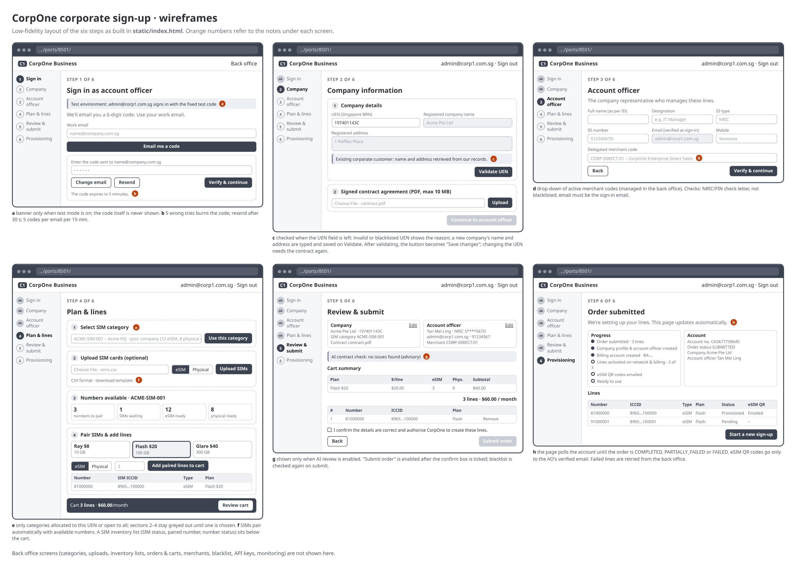
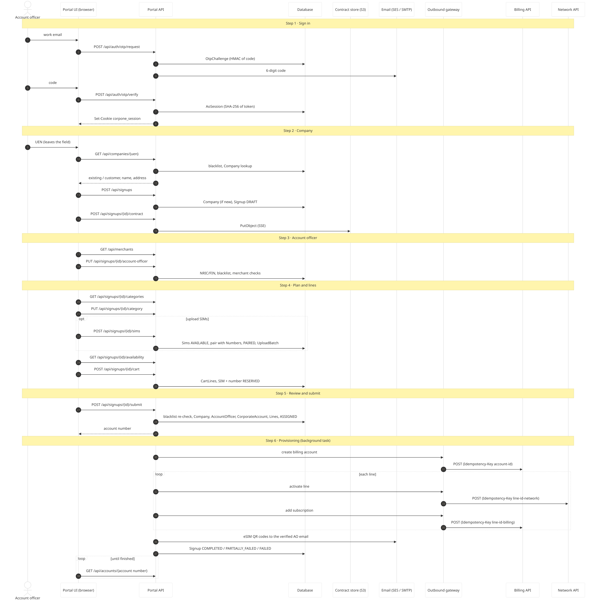
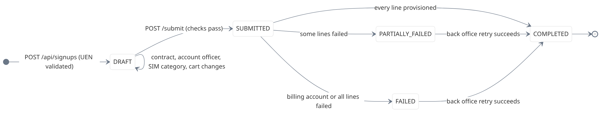
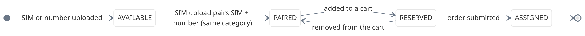

# Corporate sign-up: UML flow, artifacts and wireframes

The account officer (AO) journey from sign-in to provisioned lines, as built. For the overall
system, see [ARCHITECTURE.md](ARCHITECTURE.md); for detailed rules, the [README](../README.md).

| Artifact | File | Source |
|---|---|---|
| **draw.io file: all four UML diagrams, editable** | [uml/signup-uml.drawio](uml/signup-uml.drawio) | regenerate: `python3 docs/uml/make_drawio.py docs/uml/signup-uml.drawio` |
| UML activity diagram (flow and decisions) | [uml/signup-activity.png](uml/signup-activity.png) | [uml/signup-activity.mmd](uml/signup-activity.mmd) |
| UML sequence diagram (who calls what) | [uml/signup-sequence.png](uml/signup-sequence.png) | [uml/signup-sequence.mmd](uml/signup-sequence.mmd) |
| UML state diagram: order status | [uml/signup-state.png](uml/signup-state.png) | [uml/signup-state.mmd](uml/signup-state.mmd) |
| UML state diagram: SIM + number | [uml/line-state.png](uml/line-state.png) | [uml/line-state.mmd](uml/line-state.mmd) |
| Wireframes of the six screens | [wireframes/signup-wireframes.png](wireframes/signup-wireframes.png) | [wireframes/signup-wireframes.html](wireframes/signup-wireframes.html) |
| Artifacts per step (inputs, APIs, checks, data, errors) | this page, below | |

The `.mmd` files are Mermaid; GitHub renders them, and the PNGs were rendered from them. The `.drawio` file has one page per diagram (activity, sequence, order status, SIM + number status). Open it in draw.io / diagrams.net (File → Open) or in VS Code with the "Draw.io Integration" extension; every shape is editable. Once you edit it by hand, keep it as the source and stop regenerating it.

## Wireframes

## UML activity diagram

Actions in white, system actions in blue, decisions in orange, errors in red.

## UML sequence diagram

## UML state diagrams

Order (sign-up) status:

Each SIM + number pair:

## Artifacts per step

### Step 1 · Sign in

| | |
|---|---|
| **Screen** | Work email → "Email me a code" → 6-digit code → "Verify & continue" (Change email, Resend) |
| **API** | `POST /api/auth/otp/request` `{email}` → 202 · `POST /api/auth/otp/verify` `{email, code}` → `{email, token, expires_in}` + cookie `corpone_session` · `GET /api/auth/me` · `POST /api/auth/logout` |
| **Checks** | Code valid 5 min, single use, newest only; 5 wrong tries burns it; resend after 30 s; 5 codes per email and 20 requests per IP per 15 min |
| **Data** | `otp_challenges` (HMAC of the code), `ao_sessions` (SHA-256 of the token, 8 h) |
| **Sent** | Email with the code (`data/outbox/*.eml` in test) |
| **Errors** | 401 wrong or expired code · 429 too many requests (with `Retry-After`) |

### Step 2 · Company

| | |
|---|---|
| **Screen** | UEN, registered name, address → "Validate UEN" (then "Save changes"); signed contract PDF → "Upload" → "Continue to account officer" |
| **API** | `GET /api/companies/{uen}` (when the UEN field is left) → `{existing, customer, company_name, company_address}` · `POST /api/signups` `{uen, company_name, company_address}` → 201 sign-up · `PUT /api/signups/{id}/company` · `POST /api/signups/{id}/contract` (multipart PDF) |
| **Checks** | UEN format and check letter (business, local company, other entity); company not blacklisted; existing company: name and address from records (locked once it has an order); new company: name required. Contract: PDF, ≤ 10 MB. Changing the UEN: refused while the cart has lines; clears the contract and any category not allowed for the new UEN |
| **Data** | `companies` (saved on first validate, never duplicated) · `signups` status `DRAFT` · contract file (S3 with SSE in prod, `data/uploads/` in test) · `contract_ai_review` when AI is enabled |
| **Errors** | 400 invalid UEN / new company without a name / not a PDF · 403 blacklisted company · 409 cart has lines (UEN change) |

### Step 3 · Account officer

| | |
|---|---|
| **Screen** | Full name, designation, ID type, ID number, email (read-only, from sign-in), mobile, delegated merchant code (drop-down) → "Verify & continue" |
| **API** | `GET /api/merchants` → active codes · `PUT /api/signups/{id}/account-officer` |
| **Checks** | NRIC/FIN format and check letter (passport: format only); AO not blacklisted; mobile 8 digits starting 8 or 9; email must equal the sign-in email; merchant code exists and is active |
| **Data** | AO fields and `merchant_code` on the sign-up |
| **Errors** | 400 email mismatch / inactive merchant · 403 blacklisted AO · 422 invalid NRIC/FIN or mobile |

### Step 4 · Plan & lines

| | |
|---|---|
| **Screen** | ① Select SIM category ② Upload SIM cards (CSV `iccid[,sim_type]`, default SIM type) ③ Numbers available (numbers to pair, SIMs waiting, eSIM and physical lines ready, list of free numbers) ④ Pick plan, SIM type, quantity → "Add paired lines to cart"; cart table with Remove; SIM inventory list below; "Review cart" |
| **API** | `GET /api/signups/{id}/categories` · `PUT /api/signups/{id}/category` · `POST /api/signups/{id}/sims` · `GET /api/signups/{id}/availability` · `GET /api/signups/{id}/sims?status=…` · `GET /api/plans` · `POST /api/signups/{id}/cart` `{plan_code, sim_type, quantity}` · `DELETE /api/signups/{id}/cart/{line_id}` |
| **Checks** | Category allocated to this UEN or open to all, and active; can't change while the cart has lines. SIM upload: ICCID 18–20 digits, not a duplicate, category locked to the sign-up's. Cart: enough paired lines of that type in the category |
| **Data** | `sim_inventory` rows (`AVAILABLE` → `PAIRED` with a number), `upload_batches` (file and per-row results) · `cart_lines`; SIM and number `RESERVED`. Removing a line puts both back to `PAIRED` |
| **Errors** | 403 category not allowed · 409 no category chosen / category no longer allowed / cart has lines / not enough paired lines · 404 cart line not found |

### Step 5 · Review & submit

| | |
|---|---|
| **Screen** | Company and AO summaries (Edit links), AI contract check (if enabled), cart summary per plan, line details (Remove), monthly total, confirm checkbox → "Submit order" |
| **API** | `GET /api/signups/{id}` · `POST /api/signups/{id}/submit` → `{status, account_number, line_count}` |
| **Checks** | Still a draft; contract uploaded; AO complete; merchant active; cart not empty; company and AO not blacklisted (checked again); category still allowed; every cart SIM and number still `RESERVED` |
| **Data** | One transaction: `companies` (reused if on record), `account_officers`, `corporate_accounts` (account number `CA…`), `lines` (`PENDING`); SIM and number `ASSIGNED`; sign-up `SUBMITTED` |
| **Errors** | 409 already submitted / category no longer allowed · 422 any submit check failed (message says which) |

### Step 6 · Provisioning

| | |
|---|---|
| **Screen** | Progress timeline (order submitted, company and AO created, billing account, lines activated, eSIM QR emailed, ready), account box, lines table (status, eSIM QR) → "Start a new sign-up" |
| **API** | Background task after submit; the page polls `GET /api/accounts/{account_number}` |
| **External calls** | Through the outbound gateway (retries, circuit breaker): Billing `create_account` (`Idempotency-Key: account-<id>`), then per line Network `activate_line` (`line-<id>-network`) and Billing `add_subscription` (`line-<id>-billing`) |
| **Data** | `corporate_accounts.billing_account_ref`, `lines` → `PROVISIONED` or `FAILED` with error, `outbound_call_logs`; sign-up → `COMPLETED`, `PARTIALLY_FAILED` or `FAILED` |
| **Sent** | eSIM QR code per eSIM line (`LPA:1$<SM-DP+>$<MatchingID>`), only to the AO's verified email |
| **Recovery** | Back office "Orders & carts" shows the order and each line; `POST /api/admin/accounts/{account_number}/retry-provisioning` retries failed lines safely (same idempotency keys) |
