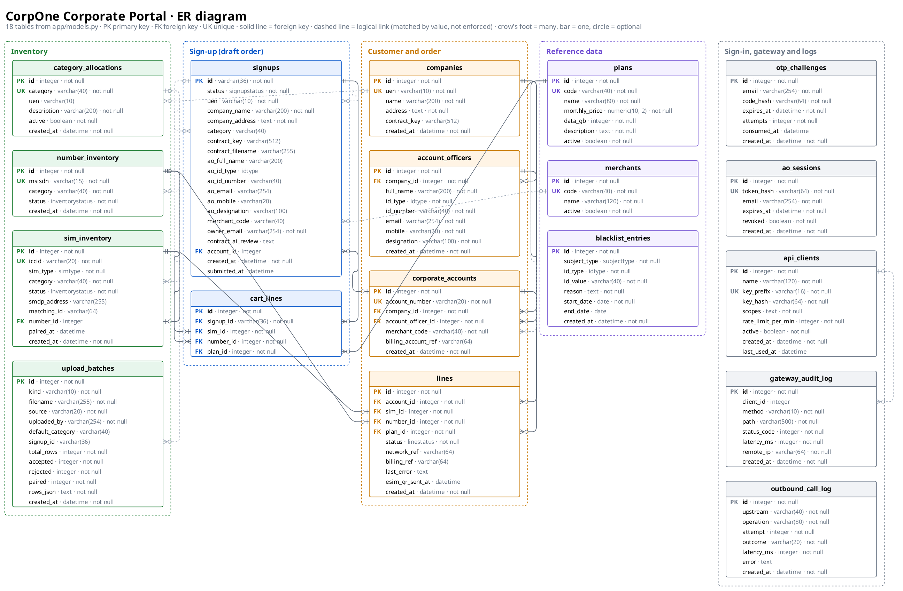

# Database schema

Generated from `app/models.py` by `docs/schema/make_schema_docs.py`; re-run it after changing the models.
The app creates these tables at startup (`Base.metadata.create_all`); there are no migrations yet, so a
schema change needs `data/corpone.db` recreated or a manual `ALTER`.

| File | What it is |
|---|---|
| [erd.mmd](erd.mmd) | ER diagram (Mermaid, rendered by GitHub) |
| [erd.png](erd.png) | ER diagram as an image (exported from erd.drawio) |
| [erd.drawio](erd.drawio) | ER diagram, editable in draw.io |
| [schema_sqlite.sql](schema_sqlite.sql) | DDL as created today (SQLite) |
| [schema_postgres.sql](schema_postgres.sql) | Same schema for PostgreSQL (production target) |

**18 tables** in 5 areas. Foreign keys are declared in the models; *logical links* are matched on a shared value in code but are not foreign keys.

## Relationships

| From | To | Kind | Cardinality |
|---|---|---|---|
| `account_officers.company_id` | `companies.id` | foreign key | one `companies` : 0..* `account_officers` |
| `sim_inventory.number_id` | `number_inventory.id` | foreign key | one `number_inventory` : 0..1 `sim_inventory`; `number_id` is optional |
| `corporate_accounts.company_id` | `companies.id` | foreign key | one `companies` : 0..* `corporate_accounts` |
| `corporate_accounts.account_officer_id` | `account_officers.id` | foreign key | one `account_officers` : 0..* `corporate_accounts` |
| `lines.account_id` | `corporate_accounts.id` | foreign key | one `corporate_accounts` : 0..* `lines` |
| `lines.sim_id` | `sim_inventory.id` | foreign key | one `sim_inventory` : 0..1 `lines` |
| `lines.number_id` | `number_inventory.id` | foreign key | one `number_inventory` : 0..1 `lines` |
| `lines.plan_id` | `plans.id` | foreign key | one `plans` : 0..* `lines` |
| `signups.account_id` | `corporate_accounts.id` | foreign key | one `corporate_accounts` : 0..* `signups`; `account_id` is optional |
| `cart_lines.signup_id` | `signups.id` | foreign key | one `signups` : 0..* `cart_lines` |
| `cart_lines.sim_id` | `sim_inventory.id` | foreign key | one `sim_inventory` : 0..1 `cart_lines` |
| `cart_lines.number_id` | `number_inventory.id` | foreign key | one `number_inventory` : 0..* `cart_lines` |
| `cart_lines.plan_id` | `plans.id` | foreign key | one `plans` : 0..* `cart_lines` |
| `signups.category` | `category_allocations.category` | logical (SIM category chosen) | matched by value, not enforced |
| `sim_inventory.category` | `category_allocations.category` | logical (category) | matched by value, not enforced |
| `number_inventory.category` | `category_allocations.category` | logical (category) | matched by value, not enforced |
| `category_allocations.uen` | `companies.uen` | logical (allocated to) | matched by value, not enforced |
| `signups.uen` | `companies.uen` | logical (company) | matched by value, not enforced |
| `signups.merchant_code` | `merchants.code` | logical (merchant) | matched by value, not enforced |
| `corporate_accounts.merchant_code` | `merchants.code` | logical (merchant) | matched by value, not enforced |
| `upload_batches.signup_id` | `signups.id` | logical (portal upload) | matched by value, not enforced |
| `gateway_audit_log.client_id` | `api_clients.id` | logical (API client) | matched by value, not enforced |

## Inventory

### `category_allocations`

Who may use a SIM category: one company (uen) or all companies (uen NULL). Inactive hides it.

| Column | Type | Null | Default | Keys |
|---|---|---|---|---|
| `id` | INTEGER | no |  | PK |
| `category` | VARCHAR(40) | no |  | UNIQUE |
| `uen` | VARCHAR(10) | yes |  | INDEX |
| `description` | VARCHAR(200) | no |  |  |
| `active` | BOOLEAN | no | true |  |
| `created_at` | DATETIME | no | auto (now) |  |

### `number_inventory`

Mobile numbers (MSISDN) by category. Added as AVAILABLE; paired by SIM uploads.

| Column | Type | Null | Default | Keys |
|---|---|---|---|---|
| `id` | INTEGER | no |  | PK |
| `msisdn` | VARCHAR(15) | no |  | UNIQUE |
| `category` | VARCHAR(40) | no |  | INDEX |
| `status` | ENUM `inventorystatus` | no | AVAILABLE | INDEX |
| `created_at` | DATETIME | no | auto (now) |  |

### `sim_inventory`

SIM cards (ICCID) by category and type, with eSIM activation data and the paired number.

| Column | Type | Null | Default | Keys |
|---|---|---|---|---|
| `id` | INTEGER | no |  | PK |
| `iccid` | VARCHAR(20) | no |  | UNIQUE |
| `sim_type` | ENUM `simtype` | no |  |  |
| `category` | VARCHAR(40) | no |  | INDEX |
| `status` | ENUM `inventorystatus` | no | AVAILABLE | INDEX |
| `smdp_address` | VARCHAR(255) | yes |  |  |
| `matching_id` | VARCHAR(64) | yes |  |  |
| `number_id` | INTEGER | yes |  | FK → number_inventory.id, UNIQUE |
| `paired_at` | DATETIME | yes |  |  |
| `created_at` | DATETIME | no | auto (now) |  |

### `upload_batches`

Every SIM or number file uploaded: who, from where, counts and every row's result (rows_json).

| Column | Type | Null | Default | Keys |
|---|---|---|---|---|
| `id` | INTEGER | no |  | PK |
| `kind` | VARCHAR(10) | no |  |  |
| `filename` | VARCHAR(255) | no |  |  |
| `source` | VARCHAR(20) | no |  |  |
| `uploaded_by` | VARCHAR(254) | no |  |  |
| `default_category` | VARCHAR(40) | yes |  |  |
| `signup_id` | VARCHAR(36) | yes |  |  |
| `total_rows` | INTEGER | no | 0 |  |
| `accepted` | INTEGER | no | 0 |  |
| `rejected` | INTEGER | no | 0 |  |
| `paired` | INTEGER | no | 0 |  |
| `rows_json` | TEXT | no | [] |  |
| `created_at` | DATETIME | no | auto (now) | INDEX |

## Sign-up (draft order)

### `signups`

Draft order an account officer fills in step by step; turns into Company / Account / Lines on submit.

| Column | Type | Null | Default | Keys |
|---|---|---|---|---|
| `id` | VARCHAR(36) | no | auto (uuid) | PK |
| `status` | ENUM `signupstatus` | no | DRAFT |  |
| `uen` | VARCHAR(10) | no |  |  |
| `company_name` | VARCHAR(200) | no |  |  |
| `company_address` | TEXT | no |  |  |
| `category` | VARCHAR(40) | yes |  |  |
| `contract_key` | VARCHAR(512) | yes |  |  |
| `contract_filename` | VARCHAR(255) | yes |  |  |
| `ao_full_name` | VARCHAR(200) | yes |  |  |
| `ao_id_type` | ENUM `idtype` | yes |  |  |
| `ao_id_number` | VARCHAR(40) | yes |  |  |
| `ao_email` | VARCHAR(254) | yes |  |  |
| `ao_mobile` | VARCHAR(20) | yes |  |  |
| `ao_designation` | VARCHAR(100) | yes |  |  |
| `merchant_code` | VARCHAR(40) | yes |  |  |
| `owner_email` | VARCHAR(254) | no |  | INDEX |
| `contract_ai_review` | TEXT | yes |  |  |
| `account_id` | INTEGER | yes |  | FK → corporate_accounts.id |
| `created_at` | DATETIME | no | auto (now) |  |
| `submitted_at` | DATETIME | yes |  |  |

### `cart_lines`

SIM + number + plan reserved in a sign-up's cart. Kept after submit.

| Column | Type | Null | Default | Keys |
|---|---|---|---|---|
| `id` | INTEGER | no |  | PK |
| `signup_id` | VARCHAR(36) | no |  | FK → signups.id, INDEX |
| `sim_id` | INTEGER | no |  | FK → sim_inventory.id, UNIQUE |
| `number_id` | INTEGER | no |  | FK → number_inventory.id |
| `plan_id` | INTEGER | no |  | FK → plans.id |

## Customer and order

### `companies`

Corporate customer, one per UEN. Saved on first validation; not overwritten after its first order.

| Column | Type | Null | Default | Keys |
|---|---|---|---|---|
| `id` | INTEGER | no |  | PK |
| `uen` | VARCHAR(10) | no |  | UNIQUE |
| `name` | VARCHAR(200) | no |  |  |
| `address` | TEXT | no |  |  |
| `contract_key` | VARCHAR(512) | yes |  |  |
| `created_at` | DATETIME | no | auto (now) |  |

### `account_officers`

Company representative (NRIC/FIN/passport) who manages the lines.

| Column | Type | Null | Default | Keys |
|---|---|---|---|---|
| `id` | INTEGER | no |  | PK |
| `company_id` | INTEGER | no |  | FK → companies.id |
| `full_name` | VARCHAR(200) | no |  |  |
| `id_type` | ENUM `idtype` | no |  |  |
| `id_number` | VARCHAR(40) | no |  |  |
| `email` | VARCHAR(254) | no |  |  |
| `mobile` | VARCHAR(20) | no |  |  |
| `designation` | VARCHAR(100) | no |  |  |
| `created_at` | DATETIME | no | auto (now) |  |

Unique together: (`company_id`, `id_type`, `id_number`)

### `corporate_accounts`

Account created on submit (account number CA…), linked to billing.

| Column | Type | Null | Default | Keys |
|---|---|---|---|---|
| `id` | INTEGER | no |  | PK |
| `account_number` | VARCHAR(20) | no |  | UNIQUE |
| `company_id` | INTEGER | no |  | FK → companies.id |
| `account_officer_id` | INTEGER | no |  | FK → account_officers.id |
| `merchant_code` | VARCHAR(40) | no |  |  |
| `billing_account_ref` | VARCHAR(64) | yes |  |  |
| `created_at` | DATETIME | no | auto (now) |  |

### `lines`

Provisioned mobile line: SIM + number + plan, with network/billing references and status.

| Column | Type | Null | Default | Keys |
|---|---|---|---|---|
| `id` | INTEGER | no |  | PK |
| `account_id` | INTEGER | no |  | FK → corporate_accounts.id, INDEX |
| `sim_id` | INTEGER | no |  | FK → sim_inventory.id, UNIQUE |
| `number_id` | INTEGER | no |  | FK → number_inventory.id, UNIQUE |
| `plan_id` | INTEGER | no |  | FK → plans.id |
| `status` | ENUM `linestatus` | no | PENDING |  |
| `network_ref` | VARCHAR(64) | yes |  |  |
| `billing_ref` | VARCHAR(64) | yes |  |  |
| `last_error` | TEXT | yes |  |  |
| `esim_qr_sent_at` | DATETIME | yes |  |  |
| `created_at` | DATETIME | no | auto (now) |  |

## Reference data

### `plans`

Monthly plans offered (Ray, Flash, Glare). Seeded at startup.

| Column | Type | Null | Default | Keys |
|---|---|---|---|---|
| `id` | INTEGER | no |  | PK |
| `code` | VARCHAR(40) | no |  | UNIQUE |
| `name` | VARCHAR(80) | no |  |  |
| `monthly_price` | NUMERIC(10, 2) | no |  |  |
| `data_gb` | INTEGER | no |  |  |
| `description` | TEXT | no |  |  |
| `active` | BOOLEAN | no | true |  |

### `merchants`

Delegated merchant codes shown in the AO step. Seeded with CORP-DIRECT-01.

| Column | Type | Null | Default | Keys |
|---|---|---|---|---|
| `id` | INTEGER | no |  | PK |
| `code` | VARCHAR(40) | no |  | UNIQUE |
| `name` | VARCHAR(120) | no |  |  |
| `active` | BOOLEAN | no | true |  |

### `blacklist_entries`

Blocked companies (UEN) and account officers (NRIC/FIN/passport), with validity dates.

| Column | Type | Null | Default | Keys |
|---|---|---|---|---|
| `id` | INTEGER | no |  | PK |
| `subject_type` | ENUM `subjecttype` | no |  |  |
| `id_type` | ENUM `idtype` | no |  |  |
| `id_value` | VARCHAR(40) | no |  | INDEX |
| `reason` | TEXT | no |  |  |
| `start_date` | DATE | no |  |  |
| `end_date` | DATE | yes |  |  |
| `created_at` | DATETIME | no | auto (now) |  |

## Sign-in, gateway and logs

### `otp_challenges`

Sign-in codes: only an HMAC of the code is stored; expiry, attempts, consumed time.

| Column | Type | Null | Default | Keys |
|---|---|---|---|---|
| `id` | INTEGER | no |  | PK |
| `email` | VARCHAR(254) | no |  | INDEX |
| `code_hash` | VARCHAR(64) | no |  |  |
| `expires_at` | DATETIME | no |  |  |
| `attempts` | INTEGER | no | 0 |  |
| `consumed_at` | DATETIME | yes |  |  |
| `created_at` | DATETIME | no | auto (now) | INDEX |

### `ao_sessions`

Account officer sessions: only a SHA-256 of the token is stored; expiry and revocation.

| Column | Type | Null | Default | Keys |
|---|---|---|---|---|
| `id` | INTEGER | no |  | PK |
| `token_hash` | VARCHAR(64) | no |  | UNIQUE |
| `email` | VARCHAR(254) | no |  | INDEX |
| `expires_at` | DATETIME | no |  |  |
| `revoked` | BOOLEAN | no | false |  |
| `created_at` | DATETIME | no | auto (now) |  |

### `api_clients`

Partner / AI-agent API keys for /gateway/v1: prefix + SHA-256 of the secret, scopes, rate limit.

| Column | Type | Null | Default | Keys |
|---|---|---|---|---|
| `id` | INTEGER | no |  | PK |
| `name` | VARCHAR(120) | no |  |  |
| `key_prefix` | VARCHAR(16) | no |  | UNIQUE |
| `key_hash` | VARCHAR(64) | no |  |  |
| `scopes` | TEXT | no |  |  |
| `rate_limit_per_min` | INTEGER | no |  |  |
| `active` | BOOLEAN | no | true |  |
| `created_at` | DATETIME | no | auto (now) |  |
| `last_used_at` | DATETIME | yes |  |  |

### `gateway_audit_log`

One row per inbound /gateway/v1 request.

| Column | Type | Null | Default | Keys |
|---|---|---|---|---|
| `id` | INTEGER | no |  | PK |
| `client_id` | INTEGER | yes |  | INDEX |
| `method` | VARCHAR(10) | no |  |  |
| `path` | VARCHAR(500) | no |  |  |
| `status_code` | INTEGER | no |  |  |
| `latency_ms` | INTEGER | no |  |  |
| `remote_ip` | VARCHAR(64) | no |  |  |
| `created_at` | DATETIME | no | auto (now) | INDEX |

### `outbound_call_log`

One row per outbound call attempt to network, billing or AI.

| Column | Type | Null | Default | Keys |
|---|---|---|---|---|
| `id` | INTEGER | no |  | PK |
| `upstream` | VARCHAR(40) | no |  | INDEX |
| `operation` | VARCHAR(80) | no |  |  |
| `attempt` | INTEGER | no |  |  |
| `outcome` | VARCHAR(20) | no |  |  |
| `latency_ms` | INTEGER | no |  |  |
| `error` | TEXT | yes |  |  |
| `created_at` | DATETIME | no | auto (now) | INDEX |

## Enum values

| Enum | Values |
|---|---|
| `idtype` | `UEN`, `NRIC`, `FIN`, `PASSPORT` |
| `inventorystatus` | `AVAILABLE`, `PAIRED`, `RESERVED`, `ASSIGNED` |
| `linestatus` | `PENDING`, `PROVISIONED`, `FAILED` |
| `signupstatus` | `DRAFT`, `SUBMITTED`, `COMPLETED`, `PARTIALLY_FAILED`, `FAILED` |
| `simtype` | `ESIM`, `PHYSICAL` |
| `subjecttype` | `COMPANY`, `ACCOUNT_OFFICER` |
