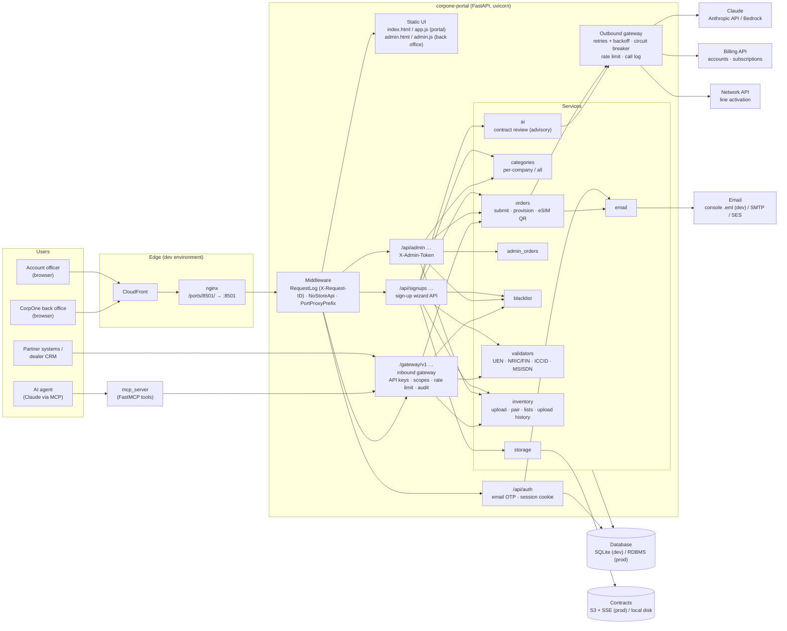
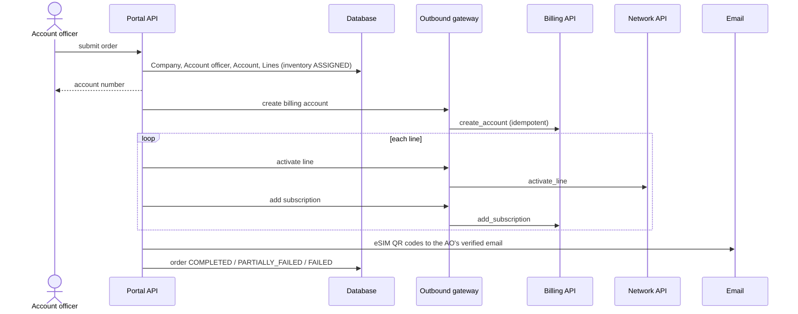
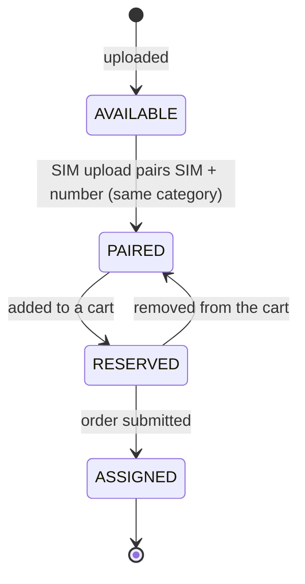

# CorpOne Corporate Portal: architecture

How the portal, back office and partner gateway fit together, end to end. For running the app and
the detailed rules of each step, see the [README](../README.md).

## Components



| Component | Code | Role |
|---|---|---|
| Portal UI | `static/index.html`, `static/app.js` | Six-step sign-up wizard for account officers (AOs) |
| Back office UI | `static/admin.html`, `static/admin.js` | Inventory, SIM categories, merchant codes, orders, blacklist, API keys, monitoring |
| Middleware | `app/main.py`, `app/request_log.py` | Request log with `X-Request-ID`; `no-store` on API responses; fingerprinted asset URLs; `/ports/<n>` proxy prefix |
| Auth API | `app/routers/auth.py`, `app/auth.py` | Email one-time code, session cookie or bearer token |
| Sign-up API | `app/routers/signups.py` | Company lookup, sign-up steps, SIM category, SIM upload, cart, submit |
| Admin API | `app/routers/admin.py` | Back office endpoints, protected by `X-Admin-Token` |
| Inbound gateway | `app/gateway/inbound.py` | `/gateway/v1` for partners and AI agents: API keys, scopes, per-key rate limits, audit log |
| MCP server | `mcp_server/server.py` | Exposes gateway calls as tools: `list_plans`, `validate_uen`, `check_blacklist`, `inventory_summary`, `get_account_status`, `retry_provisioning` |
| Services | `app/services/*.py` | Business logic: inventory and pairing, categories, orders and provisioning, blacklist, AI review, email, storage |
| Outbound gateway | `app/gateway/outbound.py`, `app/services/telco_api.py` | All calls to Network, Billing and Claude: retries with backoff, circuit breaker, rate limit, call log |

## End-to-end flow

| # | Step | Who | What happens | Components |
|---|---|---|---|---|
| 0 | **Set up inventory** | Back office | Allocate SIM categories to a company UEN, or to all companies. Upload **numbers** (added as available; no pairing), then **SIMs** (auto-paired with available numbers in the same category). Every file is recorded in Uploaded files | `/api/admin` → inventory, categories → DB |
| 1 | **Sign in** | AO | Enters email and receives a 6-digit code (HMAC-stored, 5-minute expiry, attempt and rate limits). Gets an 8-hour HttpOnly session cookie | `/api/auth` → email → DB |
| 2 | **Company** | AO | Leaving the UEN field triggers a lookup: format and check letter, blacklist, then existing customer (details retrieved and locked) or new (details saved on Validate). Uploads the signed contract PDF (≤10 MB). An optional AI contract check runs in the background | validators, blacklist → DB; storage → S3; ai → outbound gateway → Claude |
| 3 | **Account officer** | AO | Name, NRIC/FIN (check letter), mobile, and a delegated merchant code from a drop-down. Blacklist check | validators, blacklist |
| 4 | **Plan & lines** | AO | ① select a SIM category allowed for the UEN ② upload SIMs (auto-paired) ③ see available numbers ④ pick a plan and add paired lines, which become `RESERVED` in the cart | categories, inventory |
| 5 | **Review & submit** | AO | Blacklist re-checked. Creates or reuses the Company, then creates the Account officer, Corporate account and Lines. Inventory becomes `ASSIGNED` | orders → DB |
| 6 | **Provision** (background) | System | Billing: create account. For each line: Network activate, then Billing subscription. Each call is idempotent and goes through the outbound gateway. eSIM QR codes are emailed to the AO's verified email | orders → outbound gateway → Network / Billing; email |
| 7 | **Track** | AO, back office | The AO sees order status. The back office uses Orders & carts, Inventory lists, Uploaded files and Gateway monitoring, and can retry provisioning | `/api/signups`, `/api/admin` |
| – | **Integrations** | Partners, AI agents | Scoped API keys (`plans:read`, `validation:read`, `inventory:read`, `inventory:write`, `accounts:read` …) with per-key rate limits; every call audited | `/gateway/v1`, `mcp_server` |



## Inventory lifecycle



- **Number upload** only adds numbers as `AVAILABLE`.
- **SIM upload** pairs its own SIMs first (file order), then any numbers left over go to SIMs
  uploaded earlier that are still waiting. Numbers are used oldest first.
- A SIM and its number always move through the statuses together.

## Data model

```
CategoryAllocation (category → UEN | all companies, active)
Sim ──(number_id)──► MobileNumber          status: AVAILABLE → PAIRED → RESERVED → ASSIGNED
UploadBatch (file, source, uploader, per-row results)

Signup (draft order: company, AO, merchant, SIM category, status)
  └─ CartLine (Sim + MobileNumber + Plan)
        │ submit
        ▼
Company ◄─ AccountOfficer
   └─ CorporateAccount (account number, billing ref)
         └─ Line (Sim + MobileNumber + Plan, PENDING → PROVISIONED / FAILED, eSIM QR sent)

Reference:         Plan · Merchant · BlacklistEntry
Security and ops:  OtpChallenge · AoSession · ApiClient · GatewayAuditLog · OutboundCallLog
```

## Cross-cutting

| Concern | How it's handled |
|---|---|
| **Separating companies' data** | Sign-ups are private to the AO who created them. AOs see only free lines and their own cart, in categories their company may use. Upload errors never reveal another category's items |
| **Caching** | API responses are `Cache-Control: no-store, private`. Pages are `no-store`; JS and CSS URLs contain a content hash. A CDN therefore can't serve stale data, or one user's data to another |
| **Observability** | One log line per API call (method, path, status, ms, caller, `X-Request-ID`); request bodies are never logged. The gateway keeps an inbound audit log and an outbound call log |
| **Resilience** | The outbound gateway retries with backoff, has a circuit breaker per upstream and limits its own call rate. Provisioning calls are idempotent and can be retried from the back office |
| **Configuration** | `.env`, prefix `CORPONE_`: database, storage (s3/local), email (console/smtp/ses), telco API (mock/http), AI provider (disabled/anthropic/bedrock), admin token, OTP pepper |

## Dev vs production

| Part | Dev / test | Production |
|---|---|---|
| Database | SQLite `data/corpone.db`; tables created at startup | Managed RDBMS with Alembic migrations (not built yet) |
| Contracts | Local disk | S3 with server-side encryption |
| Email | `.eml` files in `data/outbox/` | SMTP or SES |
| Network and Billing APIs | Mock (`CORPONE_TELCO_API_MODE=mock`) | Real HTTP endpoints with API key |
| AI contract check | Disabled | Anthropic API or Bedrock |
| Edge | CloudFront → nginx `/ports/8501/` | Load balancer or CDN over HTTPS, `CORPONE_COOKIE_SECURE=true` |

## Known gaps

- No database migrations yet; schema changes need the SQLite file recreated.
- The per-IP sign-in code limit sees the proxy's address behind nginx, so all users share it.
- Any signed-in AO can list all active merchant codes and look up any UEN's registered name and address.
- Categories that have inventory but were never allocated are open to all companies.
